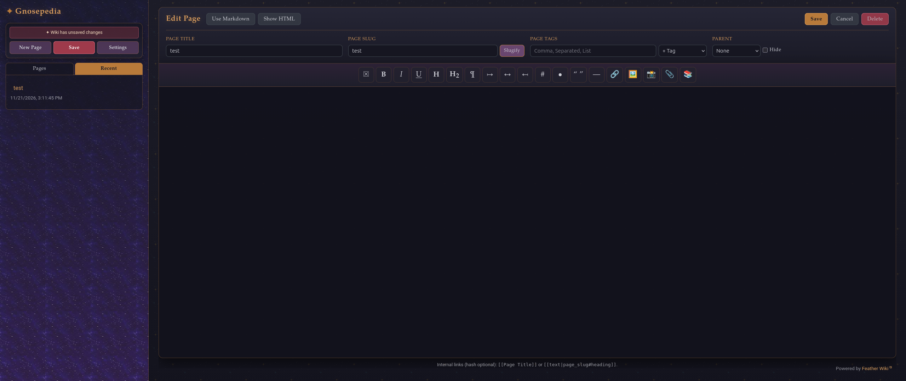
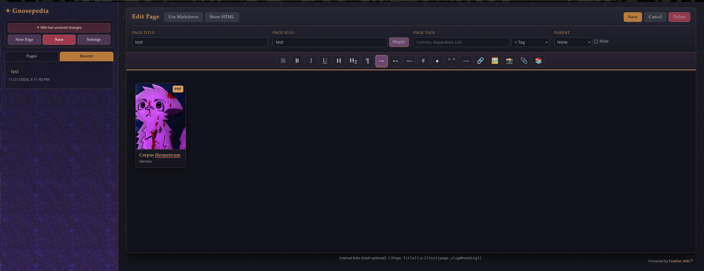
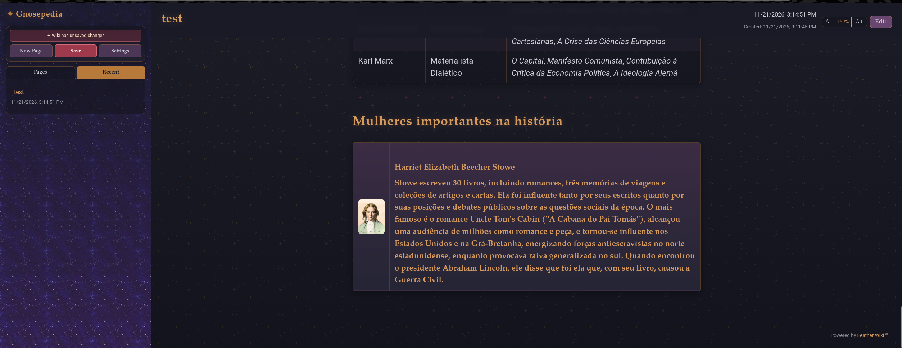
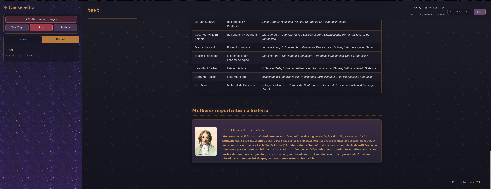

# Feather Wiki — Whimsigoth Edition (`v1.9.1 Goldfinch`)


Uma edição customizada do **[Feather Wiki](https://feather.wiki) v1.9.1 (Goldfinch)** no formato modular (**Bones, Muscles & Plumage**), com tema escuro **whimsigoth**, editor redesenhado em tela cheia, sidebar reorganizado, suporte a tabelas Markdown (GFM), widget de galeria com capas/links e controle de tamanho de fonte no modo de leitura.

---

## Principais Customizações

### 1. Tema Escuro Whimsigoth (`app/style.css`)
- Paleta escura em tons de **shadow grey** (`#20202D`), **vintage grape** (`#69466F`), **copper** (`#B87A3A`), **charcoal blue** (`#3F474F`) e **pale slate** (`#CECFD6`).
- Fundos com tiles repetidos (`background-image`) para o corpo principal e a barra lateral.
- Tipografia serifada nos títulos com destaque em cobre, divisórias sutis e scrollbar customizada.
- Layout `100vw × 100vh` com cabeçalho fixo (`sticky`) na área de leitura e barra de rolagem alinhada à borda direita da janela.

### 2. Sidebar Prático e Hierárquico
- Título da wiki destacado acima do card de ações.
- Card de cabeçalho com botões uniformes (**New Page**, **Save** e **Settings**) no mesmo tamanho e estilo, além de indicador visual de alterações não salvas.
- Abas (**Pages**, **Tags**, **Recent**) ocupando 100% da largura interna do sidebar.
- Pastas (páginas-pai) expansíveis e recolhíveis clicando tanto no ícone `▸` quanto no nome da pasta, com recuo visual e linha-guia para subpáginas.

### 3. Editor Repaginado em Tela Cheia
- Ocupa 100% da largura e altura disponíveis sem gerar scroll externo na página (apenas a área de escrita rola internamente).
- **Cabeçalho unificado** com todos os controles que antes ficavam abaixo do editor (**Use Markdown / Use Editor**, **Show HTML / Show Editor**, **Save**, **Cancel**, **Delete**) e metadados em grid compacto (**Page Title**, **Page Slug + Slugify**, **Page Tags**, **Parent** e **Hide**).
- Barra de formatação centralizada com ícones maiores e estado ativo destacado.



### 4. Widget de Galeria com Capas e Links (PDF / Arquivos)
- Botão **`📚`** integrado na barra do editor visual (WYSIWYG) e no modo Markdown.
- Modal centralizado para inserir cards com **título**, **subtítulo**, **badge/tipo** (detectado automaticamente pela extensão da URL, como `PDF`, `EPUB`, etc.), **link** e **imagem de capa** (via URL ou upload embutido na wiki com pré-visualização).
- Suporte para empilhar vários cards na mesma grade responsiva (`.fw-gallery`) e botão **`×`** ao passar o mouse no editor para remover cards facilmente.

| Modal de inserção | Pré-visualização de capa | Card no editor |
| :---: | :---: | :---: |
|  |  |  |

### 5. Controle de Tamanho da Fonte no Modo de Visualização
- Widget **`A-` | `18px` | `A+`** integrado ao cabeçalho fixo de leitura (visível também no modo publicado).
- Ajusta o tamanho da fonte apenas do conteúdo do artigo (`.uc`) em passos de `2px` (padrão `18px`), preservando o layout da interface e salvando a preferência automaticamente no `localStorage`.




### 6. Tabelas Markdown (GFM), Lightbox & Renderização de Conteúdo
- Parser Markdown interno estendido para suportar **tabelas GFM** (`| col | col |`, alinhamento de colunas e formatação interna), com wrapper responsivo (`overflow-x: auto`), bordas completas e destaque de linhas.
- Imagens em artigos centralizadas automaticamente e com **Lightbox em tela cheia** ao clicar (com legenda baseada no `alt` e fechamento por botão, clique fora ou `Esc`).




### 7. Página de Configurações (`Wiki Settings`)
- Redesenhada no mesmo padrão visual do editor, com cabeçalho fixo (**Update Settings** e **Import & Overwrite**) e seções organizadas em cards (**General**, **Output & Publishing**, **Order & Custom Code** e **Embedded Images**).


---

## Estrutura do Repositório

```text
.
├── Feather Wiki — Whimsigoth.html               # Versão normal/modular (Bones — usa app/style.css e app/app.js)
├── Feather Wiki — Whimsigoth Single File.html   # Versão minificada em arquivo único (CSS, JS e tiles em Base64)
├── app/
│   ├── app.js                                   # Motor JS customizado (Muscles)
│   └── style.css                                # Tema Whimsigoth (Plumage)
├── assets/
│   ├── 208.png                                  # Tile de fundo principal
│   ├── space_blue_nebula.jpg                    # Tile de fundo da sidebar
│   ├── main.png                                 # Imagem de capa do README
│   └── media/                                   # Imagens e capturas de tela
├── scripts/
│   ├── build_single_file.py                     # Gera a versão Single File minificada a partir da versão normal
│   ├── split_grimore.py                         # Utilitário para dividir arquivos .md por seções ##
│   └── import_to_wiki.py                        # Utilitário para importar pastas .md para o JSON da wiki
└── LICENSE
```

---

## Como Usar

### Versão Normal (Modular)
1. **Clonar ou baixar o repositório.**
2. **Abrir** `Feather Wiki — Whimsigoth.html` no navegador (diretamente ou via servidor local, ex.: `python3 -m http.server`). Opcionalmente renomeie para `index.html`.
3. **Editar e salvar:** clique em **Save** no sidebar para baixar o arquivo HTML atualizado com suas páginas (mantendo o carregamento externo de `app/style.css` e `app/app.js`).

### Versão Minificada (Single File)
1. Baixe apenas o arquivo `Feather Wiki — Whimsigoth Single File.html`.
2. Abra direto no navegador — ele é totalmente autossuficiente (HTML e CSS minificados, `app.js` embutido e tiles de fundo convertidos em Base64).

---

## Scripts Auxiliares (`scripts/`)

- **`scripts/build_single_file.py`**: gera `Feather Wiki — Whimsigoth Single File.html` embutindo `app/style.css` (minificado + assets locais em Base64) e `app/app.js` dentro do HTML base.
- **`scripts/split_grimore.py`**: divide arquivos Markdown extensos em pastas por arquivo e subarquivos por seção `##`, sem modificar os originais.
- **`scripts/import_to_wiki.py`**: importa uma hierarquia de pastas e arquivos `.md` direto para o bloco `<script id="p" type="application/json">` do HTML da wiki, criando páginas-pai para cada pasta e subpáginas para cada arquivo Markdown.

---

## Base & Créditos

- **Customização, tema Whimsigoth e extensões:** **Cassandra Lovelace**.
- **Base:** construído sobre o **[Feather Wiki](https://feather.wiki)** versão `1.9.1 (Goldfinch)` — arquitetura modular *Bones, Muscles & Plumage*.
